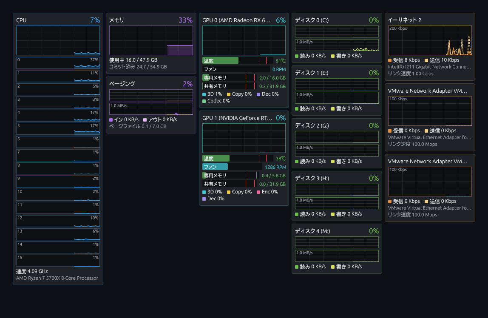

# Performance Monitor

[](https://github.com/oskbt/performance-monitor/releases/latest)
[](LICENSE)

**[最新版をダウンロード](https://github.com/oskbt/performance-monitor/releases/latest)**（Windows 10 / 11、インストール不要）

タスクマネージャーの「パフォーマンス」タブの情報を、**タブを切り替えずに 1 画面で**見られる Windows 用の常駐モニターです。
CPU・メモリ・GPU・ディスク・ネットワークのグラフを種類ごとの列に並べ、画面の隅やサブモニターに常に表示しておけます。

*A lightweight, always-on-top Windows performance monitor written in Rust. It shows everything from Task Manager's Performance tab — CPU (per thread), memory, paging, GPUs (with temperature, fan speed and VRAM meters), disks and network adapters — on a single screen, without switching tabs.*



## 特徴

- **1 画面で全部見える** — 左から CPU / メモリ / GPU / ディスク / ネットワークの列に並べ、デバイスごとのタイルを縦に積みます
- **タスクマネージャーと同じ値** — Windows のパフォーマンスカウンタ（PDH）など、タスクマネージャーと同じ取得元を使います
- **軽い** — 1 秒更新でシステム全体の CPU 使用率 0.1% 未満（Ryzen 7 5700X での実測）
- **邪魔にならない** — 背景は透明でタイトルバーなし。常に最前面に表示でき、タスクトレイに常駐します
- **管理者権限は不要** — 単一の `.exe` で動きます

## 表示項目

| 列 | 内容 |
|---|---|
| CPU | 全体の使用率、スレッド（論理プロセッサ）ごとの使用率、クロック |
| メモリ | 使用量 / 搭載量、コミット済み、ページング（ページファイル使用率、ページイン / アウト速度） |
| GPU | エンジン別（3D / Copy / Video Encode / Decode）の使用率、**温度**・**ファン回転数**・**専用 / 共有メモリ**のメーター |
| ディスク | 物理ディスクごとのアクティブ時間、読み取り / 書き込み速度 |
| ネットワーク | アダプタごとの受信 / 送信速度（Hyper-V や VMware、VPN などの仮想アダプタも表示） |

GPU のメーターは、状態に応じて色が変わります。

- **温度**: 警告温度（既定 80℃）で黄、危険温度（既定 90℃）で赤。危険温度を超えるとタイルの枠も赤く強調されます。
- **メモリ**: 使用率 80% で黄、95% で赤（VRAM が埋まるとカクつきの原因になるため）。

## 動作環境

- Windows 10（1709 以降）/ Windows 11（x64）
- GPU の情報は WDDM 2.x 以降のドライバが必要です（タスクマネージャーに GPU が表示される環境なら動きます）

## ダウンロード

[Releases](https://github.com/oskbt/performance-monitor/releases/latest) から `performance-monitor-<バージョン>-windows-x64.zip` をダウンロードして展開し、`performance-monitor.exe` を実行してください。インストールは不要です。

- 初回起動時に「Windows によって PC が保護されました」と表示された場合は、「詳細情報」→「実行」を選んでください（コード署名をしていないため表示されます）。
- 配布している exe は GitHub Actions でこのリポジトリのソースからビルドしたものです。

## ソースからビルド

[Rust](https://www.rust-lang.org/tools/install)（stable）をインストールしてからビルドします。

```bash
git clone https://github.com/oskbt/performance-monitor.git
cd performance-monitor
cargo build --release
```

`target\release\performance-monitor.exe` ができます。この 1 ファイルだけで動くので、好きな場所に置いて使ってください。

## 使い方

| 操作 | 動作 |
|---|---|
| 背景やタイルをドラッグ | ウィンドウを移動 |
| ウィンドウの端をドラッグ | サイズを変更 |
| 右クリック | 設定メニューを開く |
| トレイアイコンを左クリック | 表示 / 非表示を切り替え |
| トレイアイコンを右クリック | 表示切替・終了のメニュー |

右クリックメニューでは次の設定ができます。

- タイルごとの表示 / 非表示
- CPU のスレッド別表示、コンパクト表示
- ウィンドウのサイズと位置の固定、常に最前面、不透明度
- 更新間隔（0.5 / 1 / 2 / 5 秒）
- Windows 起動時の自動起動
- タスクトレイに隠す、終了

## 設定ファイル

設定は `%APPDATA%\performance-monitor\config.toml` に保存されます。メニューにない項目は、このファイルを直接編集して変更できます。

```toml
gpu_temp_warning = 80.0   # GPU 温度の警告しきい値 (℃)
gpu_temp_danger = 90.0    # GPU 温度の危険しきい値 (℃)
history_seconds = 60      # グラフに表示する期間（秒）
```

## 制限事項

- **CPU 温度は表示しません。** Windows 標準の手段では取得できない環境が多く、正確な値を読むにはカーネルドライバと管理者権限が必要になるためです。
- GPU の温度・ファン回転数は、ドライバが報告しない場合「取得不可」と表示されます。ファンが 0 RPM のときは、低温時にファンを止める機能で停止している状態です。
- メモリ使用量は約 95MB です。大半は GPU ドライバ（OpenGL）の分です。

## 技術的な詳細

設計や各値の取得方法は [仕様書（docs/SPEC.md）](docs/SPEC.md) にまとめています。

- GUI: [eframe / egui](https://github.com/emilk/egui)
- Windows API: [windows-rs](https://github.com/microsoft/windows-rs)（PDH、DXGI、D3DKMT、IP Helper）
- タスクトレイ: [tray-icon](https://github.com/tauri-apps/tray-icon)
- 日本語フォント: [BIZ UDPGothic](https://github.com/googlefonts/morisawa-biz-ud-gothic) の、画面表示に使う文字だけを切り出したサブセット（約 80KB）を exe に埋め込んでいます。ネットワークアダプタ名などにサブセットに無い文字が現れた場合だけ、システムの日本語フォントを追加で読み込みます。画面に出す日本語を変更したら `python tools/make_font_subset.py <BIZUDPGothic-Regular.ttf>` でサブセットを作り直してください（`cargo test` が収録漏れを検出します）。

## ライセンス

[MIT License](LICENSE)

同梱しているフォント（`assets/fonts/BIZUDPGothic-subset.ttf`）は BIZ UDPGothic のサブセットで、[SIL Open Font License 1.1](assets/fonts/OFL.txt) に従います。
配布用 zip には、exe に組み込んでいるライブラリ・フォントのライセンス表示（`THIRD_PARTY_LICENSES.txt`、`tools/third_party_licenses.py` で生成）を同梱しています。

### リリース手順（メンテナー向け）

`Cargo.toml` の `version` を上げてコミットし、同じ番号のタグを push すると、GitHub Actions がビルドして Release を作成します。

```bash
git tag v0.1.0
git push origin v0.1.0
```
